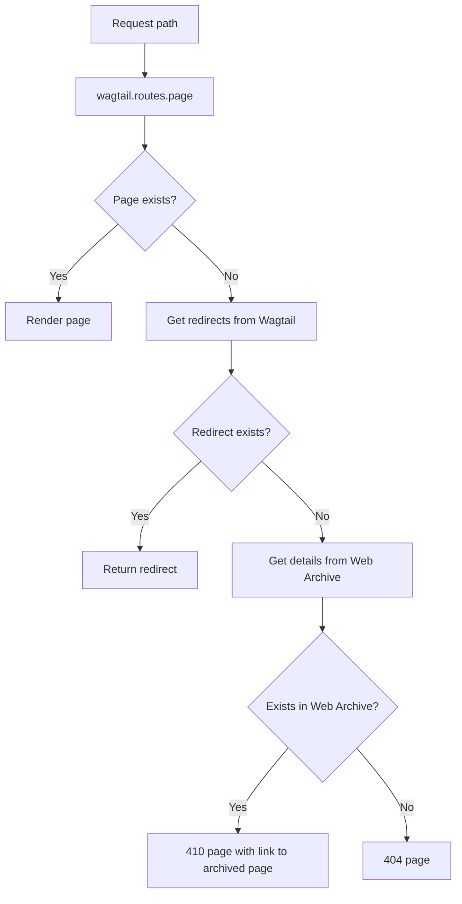

# Routes

## Normal Wagtail page routing process

1. User requests URL (e.g. `https://www.nationalarchives.gov.uk/explore-the-collection/`)
1. Routes processed in `app/__init__.py`
1. Check for static routes first (`feeds`, `main`, `search`, `sitemaps`)
1. If no matching routes are found use the `wagtail` blueprint
1. Pass the path (e.g. `/explore-the-collection/`) into the `page` function in `app/wagtail/routes.py`
1. Pass the path to the API in order to find the page (`/api/v2/pages/find/?html_path=/explore-the-collection/`)
1. API redirects to page details (`/api/v2/pages/5/`)

The `get_requested_accept` decorator passes the negotiated media type to `page`
as the `preferred_content_type` keyword argument and adds `Vary: Accept` to the
response. Place it below the Flask route decorators so Flask registers the wrapped
function. The supported types are `text/html` (the default) and `text/markdown`;
negotiation uses Werkzeug's `request.accept_mimetypes.best_match`. Equally
preferred matches with the same specificity use the supported-type order (HTML
first), and entries with invalid quality values are ignored.
If the header is missing or neither type is acceptable, the argument is `None`
and the page falls back to HTML,
including when all supported types have `q=0`, rather than returning `406`.
Markdown responses convert only the rendered `<main>` element, or the whole HTML
document if `<main>` is absent. An empty `<main>` produces empty Markdown.
Response status codes, cache headers, repeated headers and existing `Vary` values
are preserved; content type and length reflect the Markdown body. Redirects and
error responses, including errors returned by the renderer, remain unchanged
apart from adding `Accept` to `Vary`. Only successful responses are converted;
validators and digests for the original HTML body are removed after conversion.

### Serving page logic

## Page previews

The `preview_page` function in `app/wagtail/routes.py` responds to requests from Wagtail to preview pages in draft.

## Password protected pages

If the page returned from Wagtail is password protected, the request will be redirected to the `/preview/<int:page_id>/` path (handled by `preview_protected_page`) which will display a page for users to be able to enter a password in order to view the page.

## Permalinks

Because slugs and paths can change, each Wagtail page has a permalink in the format `/page/<int:page_id>/`, handled by `page_permalink`.

The permalink is referenced in the blog's RSS and Atom feeds.
